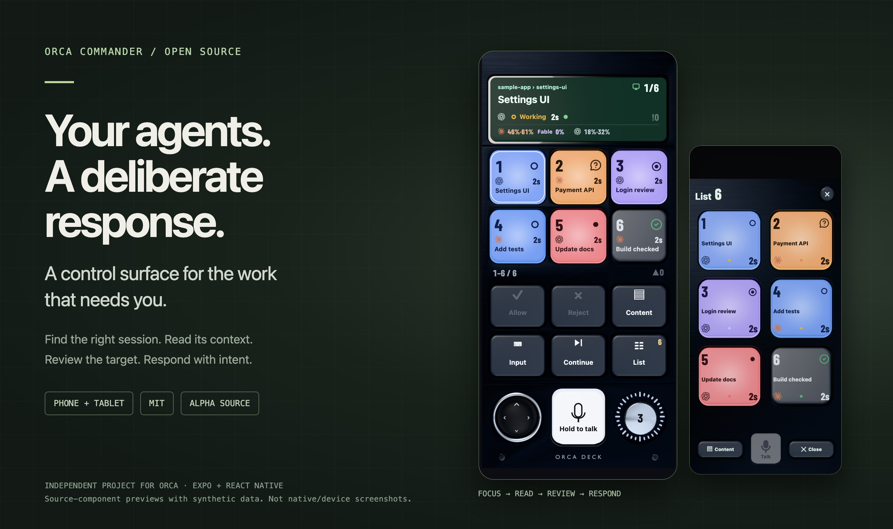
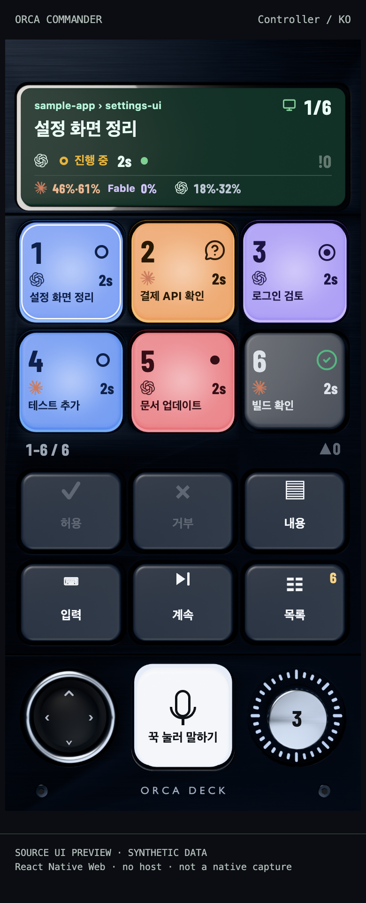
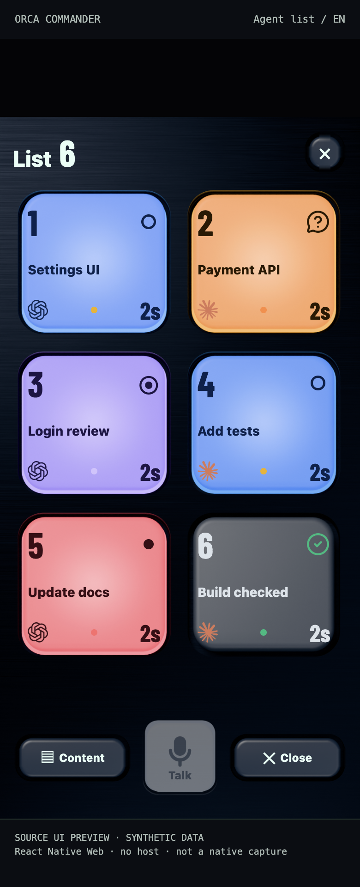
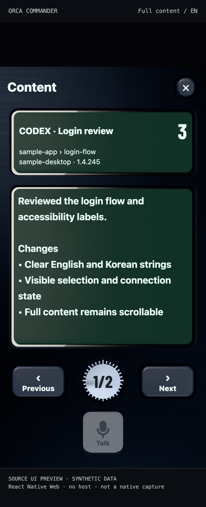
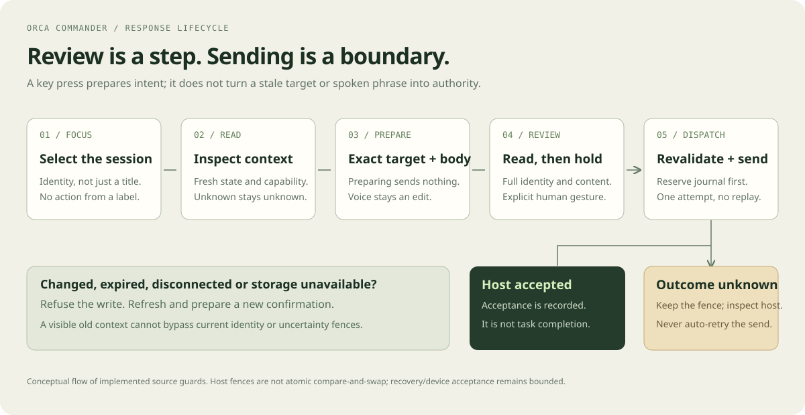
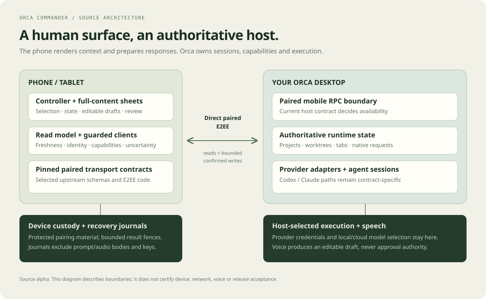

# Orca Commander

**[Orca](https://github.com/stablyai/orca)를 위한 휴대폰·태블릿 컨트롤 화면입니다.**

응답이 필요한 세션을 찾고, 맥락을 읽고, 대상과 내용을 확인한 뒤 의도적으로 답합니다.

[English](README.md) · [시작 가이드](docs/GETTING_STARTED.md) · [화면 갤러리](docs/GALLERY.md) · [문서](docs/README.md) · [기여 안내](CONTRIBUTING.md)



> **직접 빌드하는 알파 소스입니다.** 안정 버전 바이너리나 스토어 배포본은 제공하지 않습니다. 고위험 항목을 포함한 의존성 경고가 남아 있습니다. 실행 전에 [지원 범위](SUPPORT.md)와 [의존성 보안 상태](docs/DEPENDENCY_SECURITY.md)를 확인하세요.
>
> 이미지는 **실제 소스 컴포넌트를 React Native Web에서 합성 데이터로 렌더링한 미리보기**입니다. 실기기 캡처·실제 연결 세션·기기나 음성 동작의 검증 증거가 아닙니다. [출처와 재현 방법 →](docs/GALLERY.md)

## 어떤 문제를 다루나요?

여러 에이전트가 동시에 일하면 한쪽에서는 질문이 오고, 다른 쪽에서는 작업이 끝나고, 또 다른 쪽에서는 검토가 필요해집니다. Commander는 이런 순간에 사람이 보고 답할 자리를 휴대폰이나 태블릿에 둡니다.

- **대상을 놓치지 않습니다.** 세션 키에 제목·제공자·상태를 묶고, 표시창에는 프로젝트·워크트리·선택 위치·읽기 경과·호스트가 보고한 사용량을 둡니다.
- **손으로 빠르게 이동합니다.** 키를 누르거나 컨트롤러 표면을 스와이프하고, 스틱과 주의 항목 다이얼로 탐색합니다.
- **전체 맥락을 읽습니다.** 별도 본문 화면에서 받은 원문을 스크롤합니다. 페이지 조작은 보기 위치를 바꾸며 원문을 재작성하지 않습니다.
- **전송을 분명하게 확인합니다.** 텍스트와 지원되는 구조화 응답은 대상·내용 검토, 명시적인 확인, 최신 상태 재검증을 거쳐 한 번 시도합니다.
- **모르는 결과를 감추지 않습니다.** 결과가 불확실하면 호스트를 직접 확인할 때까지 차단을 유지합니다. 재연결이 전송을 자동 재시도하지 않습니다.
- **음성은 초안으로 씁니다.** 호스트가 선택한 모델의 전사 결과를 편집합니다. 말만으로 승인하거나 자동 전송하지 않으며, 음성 전체 경로의 수용 검증은 남아 있습니다.

[조작 안내](docs/USER_GUIDE.md) · [설계 원칙](docs/DESIGN.md) · [정확한 지원 범위와 한계](SUPPORT.md)

## 화면으로 보기

<table><tr>
<td align="center"><b>선택</b><br></td>
<td align="center"><b>찾기</b><br></td>
<td align="center"><b>읽기</b><br></td>
</tr></table>

[전체 갤러리](docs/GALLERY.md)에서 상태·사용량, 음성 초안, 태블릿의 아홉 키 배치도 볼 수 있습니다.

## 선택에서 전송까지



확인 화면을 준비하는 것만으로는 쓰기가 발생하지 않습니다. 전송 시점에도 연결·대상·권한이 유효해야 하며, 저장소를 사용할 수 없거나 미확인 결과가 있으면 전송이 막힐 수 있습니다. **호스트 수신과 작업 완료는 다른 결과입니다.**

## 소스 빌드

**Node.js 24**를 사용합니다. Expo SDK 55·React Native 0.83.10 기반이며, 소스 테스트도 `PATH`에서 Ruby 2.7 이상을 찾아야 합니다. 기록된 로컬 검사는 Ruby 3.1.0으로 실행했습니다.

```sh
git clone https://github.com/Two-Weeks-Team/orca-commander.git
cd orca-commander
npm --prefix apps/mobile ci --ignore-scripts --no-audit --no-fund
npm start
```

해당 플랫폼 개발 도구를 설치한 뒤 실행합니다.

```sh
npm --prefix apps/mobile run ios
# 또는
npm --prefix apps/mobile run android
```

사용자 정의 네이티브 모듈이 있어 **Expo Go만으로는 실행할 수 없습니다.** 서명 정보와 프로덕션 바이너리는 제공하지 않습니다. 빌드·첫 연결·문제 해결은 [시작 가이드](docs/GETTING_STARTED.md)를 참고하세요.

네이티브 빌드나 페어링 없이 화면만 살펴보려면 별도의 [로컬 시각 미리보기](scripts/showcase/README.md)를 사용할 수 있습니다. 실제 UI 컴포넌트에 합성 데이터를 넣으며, Orca에 연결하거나 명령을 보내지 않습니다.

## 구조와 문서



| 알고 싶은 내용 | 문서 |
|---|---|
| 어떤 화면이 있고 어떻게 조작하나요? | [갤러리](docs/GALLERY.md), [사용 가이드](docs/USER_GUIDE.md) |
| 왜 이런 키·표시창·확인 흐름인가요? | [설계](docs/DESIGN.md) |
| 상태와 전송은 어떻게 분리되나요? | [아키텍처](docs/ARCHITECTURE.md) |
| 코드를 읽거나 수정하려면요? | [개발 가이드](docs/DEVELOPMENT.md), [기여 안내](CONTRIBUTING.md) |
| 구현·검증된 범위와 남은 일은요? | [지원 범위](SUPPORT.md), [검증 기록](docs/VERIFICATION.md), [로드맵](docs/ROADMAP.md) |

## 검증과 기여

```sh
node scripts/verify-upstream.mjs
node scripts/test-vendor-tools.mjs
npm test
npm run typecheck
npm --prefix apps/mobile run test:prebuild
```

CI는 고정한 두 업스트림 버전의 원본 Mobile TypeScript와 선택한 프로토콜·E2EE 계약도 검사합니다. 이러한 합성 검사는 네이티브 빌드나 실기기 수용 검증을 대신하지 않습니다.

재현 가능한 버그, 소스에 근거한 설계 의견, 번역 개선, 집중된 패치를 환영합니다. 관련 외부 프로젝트나 글은 출처와 개선하려는 점을 함께 제안해 주세요. 구현과 실험은 비공개에서 진행하고, 검토·검증한 변경을 이 공개 저장소로 전달합니다.

전용 USB-C 데스크 컨트롤러는 **향후 설계 방향**입니다. 하드웨어·펌웨어·데스크톱 브리지는 아직 제공하지 않습니다. 앱의 음성·접근성·복구·플랫폼 전체 검증과 배포 작업도 남아 있습니다. [로드맵 →](docs/ROADMAP.md)

공개 프로젝트 이름은 **Orca Commander**이며, 네이티브 앱에는 연속성을 위해 기존 **Orca Deck** 이름·앱 ID·보호 저장소 이름이 남아 있습니다. 공식 Orca 제품은 아닙니다.

## 라이선스

자체 코드와 직접 제작한 자산은 [MIT](LICENSE)입니다. 포함한 코드·글꼴·아이콘·제공자 마크에는 [제3자 고지](THIRD_PARTY_NOTICES.md)의 별도 조건이 적용됩니다. MIT는 상표 사용권이나 공식 후원을 의미하지 않습니다.
