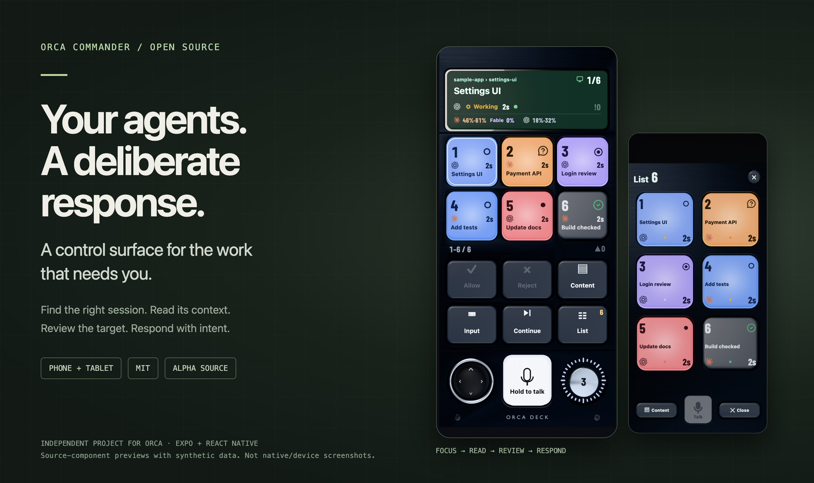
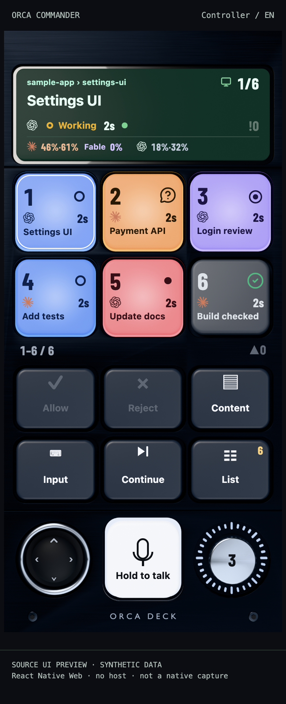
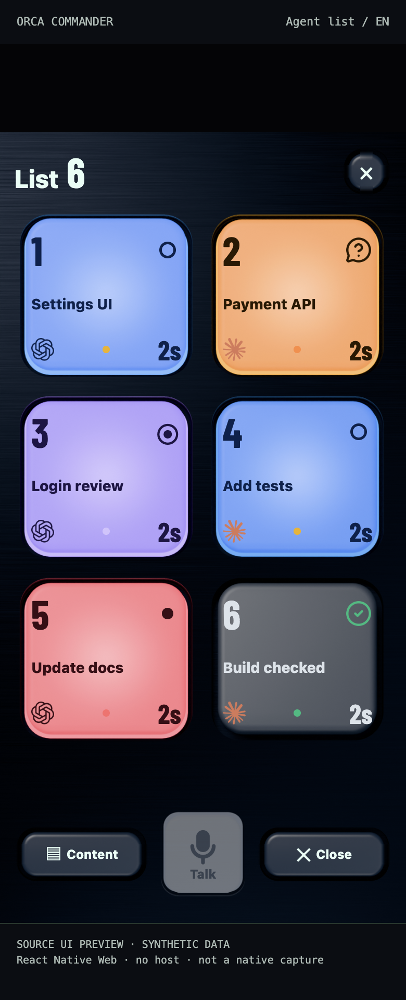
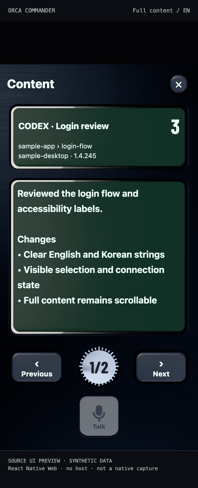
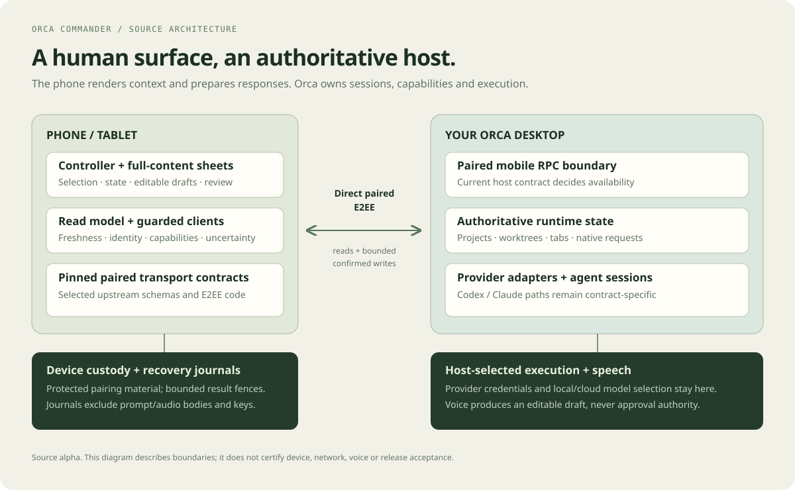

# Orca Commander

**A phone and tablet control surface for [Orca](https://github.com/stablyai/orca).**

Find the session that needs you. Read its context. Review the target. Respond deliberately.

[한국어](README.ko.md) · [Getting started](docs/GETTING_STARTED.md) · [Screens & design](docs/GALLERY.md) · [Documentation](docs/README.md) · [Contributing](CONTRIBUTING.md)



[](https://github.com/Two-Weeks-Team/orca-commander/actions/workflows/contract-check.yml)
[](https://github.com/Two-Weeks-Team/orca-commander/actions/workflows/upstream-contract.yml)
[](LICENSE)

> **Alpha source, build it yourself.** This independent project has no stable binary or store release. The dependency audit has unresolved findings, including high-severity entries. Read the [support matrix](SUPPORT.md) and [dependency security status](docs/DEPENDENCY_SECURITY.md) before running it.
>
> Images are **real source components rendered on React Native Web with synthetic data**. They are not native-device screenshots, live sessions or proof of device/voice acceptance. [Gallery and reproduction details →](docs/GALLERY.md)

## Why a control surface?

Several agent sessions can need different things at once: one asks a question, another finishes, a third needs a review. Commander gives the human side of that work a persistent place on a phone or tablet.

- **Focus without losing the target.** Session keys keep title, provider and state together. The display shows project/worktree context, position, read age and host-reported usage.
- **Navigate by touch.** Tap a key, swipe the controller surface or use the stick. The attention dial moves between items that need a response.
- **Read before responding.** Open the complete received content in its own reader; navigation controls move the viewport without rewriting the source text.
- **Make intent explicit.** Text and supported structured responses go through target/content review, deliberate confirmation, fresh checks and one attempt.
- **Keep uncertainty visible.** An unknown send result stays fenced until you inspect the host. Reconnecting does not automatically replay a mutation.
- **Use voice as a draft.** Host-selected transcription produces editable text. Speaking never approves or sends by itself; end-to-end voice acceptance is still open.

[User guide](docs/USER_GUIDE.md) · [Interaction design](docs/DESIGN.md) · [Exact support and limits](SUPPORT.md)

## See the app

<table>
<tr>
<td align="center"><b>Focus</b><br></td>
<td align="center"><b>Find</b><br></td>
<td align="center"><b>Read</b><br></td>
</tr>
</table>

The [full gallery](docs/GALLERY.md) includes connection/usage, voice-draft, Korean and nine-key wide-layout previews, with source and image provenance.

## From selection to a confirmed response


A prepared confirmation is not a write. The current target and connection must still be valid when sending; unavailable storage or an unresolved outcome can block it. **Host acceptance is different from task completion.** These are implemented guard boundaries, not a claim that every platform or interruption has been accepted.

[Architecture and trust boundaries →](docs/ARCHITECTURE.md)

## Build the source

Use **Node.js 24**. Native development uses Expo SDK 55 and React Native 0.83.10; the source tests also need Ruby 2.7+ on `PATH` (the recorded local run used Ruby 3.1.0). For native builds, install the iOS or Android development toolchain.

```sh
git clone https://github.com/Two-Weeks-Team/orca-commander.git
cd orca-commander
npm --prefix apps/mobile ci --ignore-scripts --no-audit --no-fund
npm start
```

With the platform toolchain installed:

```sh
npm --prefix apps/mobile run ios
# or
npm --prefix apps/mobile run android
```

This app has custom native modules and needs a development client. **Expo Go is insufficient.** No signing identity or production binary is supplied. The [getting-started guide](docs/GETTING_STARTED.md) covers the build path, initial connection, safe first checks and troubleshooting.

To see the UI without a native build or pairing, use the separate [local visual preview](scripts/showcase/README.md). It renders the included components with inert host callbacks; it is not a web client for Orca.

## How it is built



The Expo/React Native UI, pure domain policies and native/host adapters are separate. Selected upstream contracts are vendored at two exact pins with their notices and hashes. The host remains authoritative for worktrees, sessions, capabilities and provider execution.

```text
apps/mobile/app/          App entry and navigation
apps/mobile/src/ui/      Controller, reader, sheets and confirmation
apps/mobile/src/core/    Selection, freshness, policy and gesture models
apps/mobile/src/adapters/ Pairing, transport, reads, guarded writes and journals
apps/mobile/src/upstream/ Pinned upstream source and licenses
apps/mobile/tests/       Domain, source, JSX, asset and recovery checks
scripts/showcase/        Separate documentation-only visual renderer
```

[Architecture](docs/ARCHITECTURE.md) · [Design](docs/DESIGN.md) · [Development guide](docs/DEVELOPMENT.md) · [Upstream pins](docs/UPSTREAM.md)

## Check and contribute

```sh
node scripts/verify-upstream.mjs
node scripts/test-vendor-tools.mjs
npm test
npm run typecheck
npm --prefix apps/mobile run test:prebuild
```

CI also checks the two pinned upstream versions, their original Mobile TypeScript and selected protocol/E2EE contracts. These synthetic checks do not replace native builds or real-device acceptance. See the [verification record](docs/VERIFICATION.md).

Useful contributions include reproducible bug reports, source-grounded design feedback, translation improvements and focused patches. Share relevant external work with its source and explain what it would improve. [Start here →](CONTRIBUTING.md)

Implementation and experiments happen privately. This repository receives reviewed, coherent snapshots with independent history. Public feedback is evaluated before it becomes a capability or a verified fix.

## Status and direction

The source contains a controller, full-content sheets, guarded input, bounded Codex/Claude response paths, recovery journals and English/Korean UI. Broad voice/accessibility acceptance, full recovery/platform coverage and distribution remain open. A dedicated USB-C desk controller is a **future design direction**; no hardware, firmware or desktop bridge is delivered.

[Roadmap](docs/ROADMAP.md) · [Support matrix](SUPPORT.md) · [Known security findings](docs/DEPENDENCY_SECURITY.md) · [Changelog](CHANGELOG.md)

The native app still uses the legacy **Orca Deck** name, identifiers and protected-store namespaces for continuity. The public project is **Orca Commander**. It is not an official Orca product.

## License

Original code and directly created assets are [MIT licensed](LICENSE). Vendored code, fonts, icons and provider marks retain their separate terms in [THIRD_PARTY_NOTICES.md](THIRD_PARTY_NOTICES.md). The MIT license grants no trademark rights, sponsorship or endorsement.
