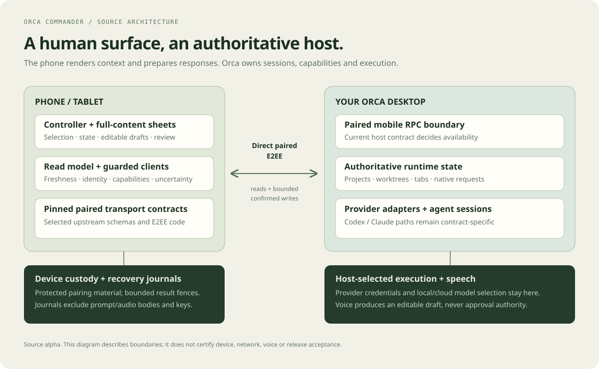

# Architecture

[Documentation](README.md) / Architecture

Orca Commander is an Expo/React Native client. It reads a paired Orca host and presents a controller or list; the host owns worktrees, sessions, capabilities and provider state. The mobile surface does not become a new agent runner or a source of host authority.

## Modules and boundaries

| Area | Responsibility | Entry points |
|---|---|---|
| App composition | Own long-lived session/clients and screen lifecycle | [app-session.ts](../apps/mobile/src/app-session.ts), [app/index.tsx](../apps/mobile/app/index.tsx) |
| Pairing and custody | Parse/validate pairing input; use protected platform storage | [pairing-store.ts](../apps/mobile/src/adapters/pairing-store.ts), [secure-store.ts](../apps/mobile/src/adapters/secure-store.ts) |
| Direct transport | Adapt selected pinned paired-E2EE contracts | [direct-e2ee-transport.ts](../apps/mobile/src/adapters/direct-e2ee-transport.ts) |
| Live reads | Bound connection generation, normalize inventory and refresh state | [app-live-session.ts](../apps/mobile/src/adapters/app-live-session.ts), [orca-read-model.ts](../apps/mobile/src/adapters/orca-read-model.ts) |
| Domain model | Bind selection, freshness, capacity and uncertainty independently of artwork | [deck-model.ts](../apps/mobile/src/core/deck-model.ts), [project-focus.ts](../apps/mobile/src/core/project-focus.ts) |
| Guarded text | Prepare/revalidate exact target and body; reserve a send and classify the result | [action-client.ts](../apps/mobile/src/adapters/action-client.ts) |
| Bounded responses | Validate supported native/structured request identities and contracts | [structured-action-client.ts](../apps/mobile/src/adapters/structured-action-client.ts) |
| Default-agent instruction | Separate supported launch/replay contract and uncertainty journal | [host-default-agent-client.ts](../apps/mobile/src/adapters/host-default-agent-client.ts) |
| Recovery | Retain bounded send/request outcome metadata and prevent unsafe repeats | [action-journal.ts](../apps/mobile/src/adapters/action-journal.ts), [structured-request-journal.ts](../apps/mobile/src/adapters/structured-request-journal.ts) |
| Presentation | Render selected context, controls, full-content sheets and confirmation | [DeckHome](../apps/mobile/src/ui/deck-home.tsx), [DeckScreen](../apps/mobile/src/ui/deck/DeckScreen.tsx), [ConfirmPanel](../apps/mobile/src/ui/confirmation-panel.tsx) |

## Read flow

A successful connection establishes a generation and the host's usable contract. Read adapters normalize worktree/tab/request data into the app's model. Selection binds identity and source evidence; it is not a join inferred from a title.

Freshness and inventory completeness have separate jobs. The UI can show partial counts or retained presentation while a fresh read is pending. Absence decisions and action eligibility must not silently borrow authority from that display. Duplicate/unknown rows stay unproven.

The selected project/tab order and visible key capacity are presentation/domain choices. They do not introduce a new RPC. Source pins and current runtime checks determine what can actually be read or sent.

## Write flow

1. Prepare an exact target, content and supported action/request revision. Preparing does not mutate the host.
2. Present full identity/content and require a deliberate confirmation gesture. The UI owns presentation and gesture continuity, not final target authority.
3. Revalidate the live connection, current target and supported contract at the action-client boundary.
4. Reserve bounded recovery state before dispatch. Unavailable storage is a refusal, not a reason to send without the fence.
5. Attempt once and classify the response. A host acceptance is not proof of task completion; lost/ambiguous results retain uncertainty.

The current host fences are not an atomic compare-and-swap guarantee. See [support](../SUPPORT.md) and the [verification record](VERIFICATION.md) for limits and original failures. The diagram is not a security certification.

## Persistence and privacy

Pairing material belongs in protected platform storage. Send/request journals keep bounded recovery identity, time and outcome metadata; they exclude prompt/audio/transcript bodies and authentication keys. Local display/binding/preferences state has its own scope and must not turn a retained view into action permission.

Unsent text/voice drafts are a different concern from durable outcome metadata. A restart, uninstall, data clear, key loss or restored backup has different consequences; do not treat them as equivalent recovery paths. In particular, destroying local state can remove a resend fence.

No Deck analytics collector or enabled external-advisor API is introduced by this snapshot. Speech can use a host-selected local or cloud model. Voice produces editable drafts and remains outside approval authority; full voice/narration acceptance is still open.

## Upstream boundary

Two vendored selections are integrity-checked: 13 files at the initial pin and 60 at the installed pin. The exact public upstream revisions, notices and manifest locations are documented in [UPSTREAM.md](UPSTREAM.md).

The compatibility workflow checks original Mobile TypeScript and selected original protocol/E2EE/host contracts against those pins. It is stronger evidence than a copied schema compiling locally, but it remains bounded synthetic/loopback verification rather than acceptance on all host versions or devices.

## Documentation renderer

The [visual preview tool](../scripts/showcase/README.md) imports selected UI/domain components and supplies synthetic data through a documentation-only React Native Web environment. Native image/safe-area/feedback/provider boundaries are adapted. Its build rejects unexpected live app-adapter imports.

It does not load `app-session.ts`, create pairing storage, open an E2EE channel, invoke speech or construct a host action client. A `LIVE` label, percentage or transcript in those images is a fixture. The renderer has a separate tooling lockfile; it is not the mobile application's dependency graph or a production web port.

## Extension rules

A new visual control should emit semantic intent into an existing guarded flow. A new host call needs an explicit supported contract, identity/freshness checks, bounded error behavior and appropriate uncertainty handling. Provider-native requests need their own verified identity; a pane title or terminal fragment is insufficient.

Keep pure policy in `core/`, platform/host effects in `adapters/` and full review visible in `ui/`. A future USB controller must preserve those boundaries rather than placing credentials or write authority in a peripheral.

[Development guide](DEVELOPMENT.md) · [Design](DESIGN.md) · [Security policy](../SECURITY.md)
