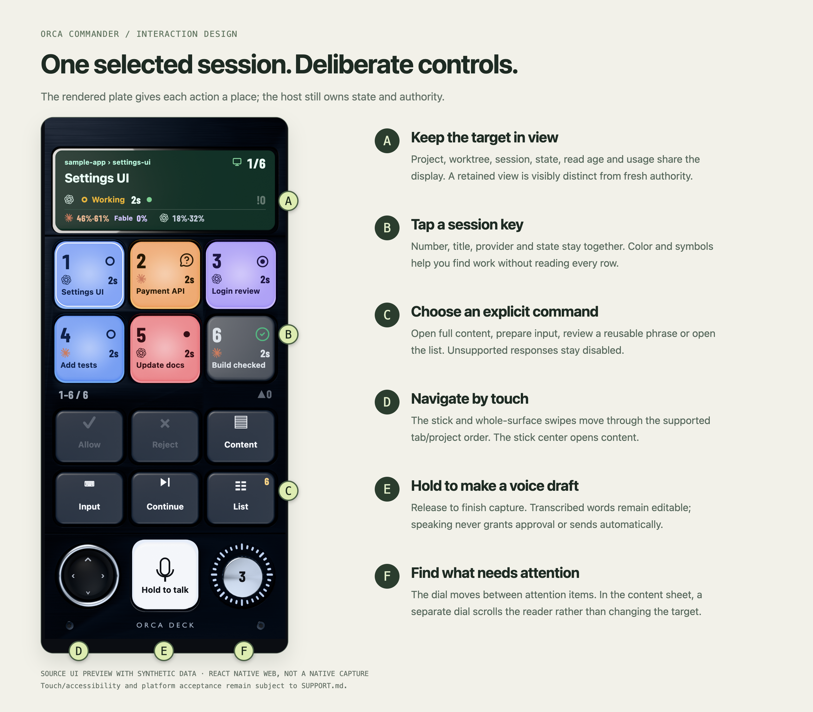
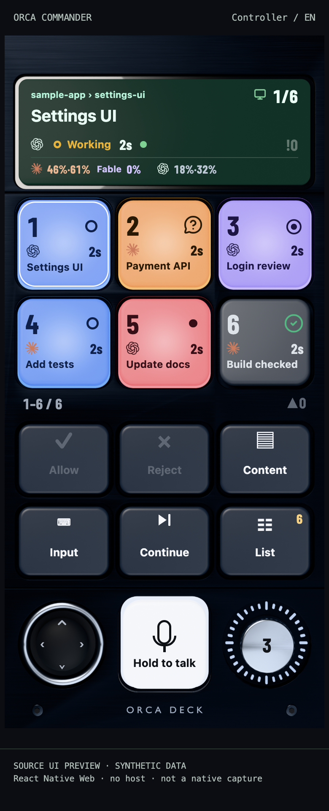
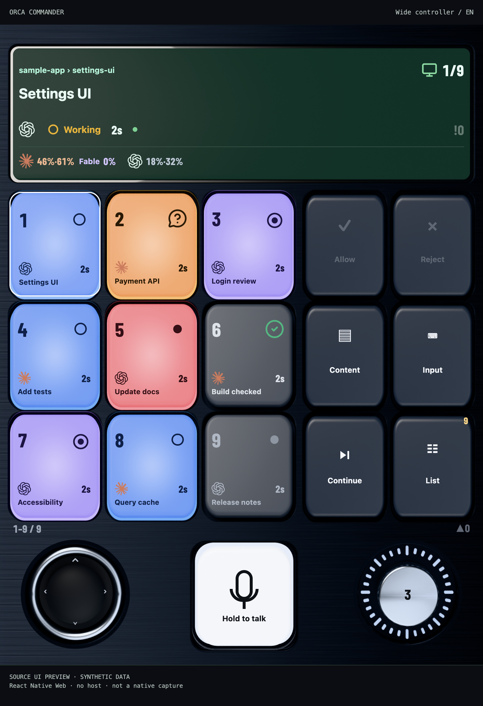

# Interaction and visual design

[Documentation](README.md) / Design

Commander explores a simple idea: give the human response to agent work a stable physical-looking surface. A session has a place, reading has its own space, and a response requires a deliberate boundary.

This document describes the included source, its visual vocabulary and future hardware direction. It is not a device-acceptance report.

## The controller is a map of actions

The interface groups three kinds of work:

1. **Orient:** read selected project/worktree, session, state and freshness.
2. **Navigate:** choose a key, move within supported project/tab order or jump between attention items.
3. **Respond:** inspect complete content, edit input, then enter a separate confirmation.

The physical-looking plate supplies continuity; labels, state and hit targets are UI elements over the artwork. Buttons are not a flattened screenshot with invisible hotspots. The full reader and confirmation remain distinct from the compact key captions.

## Why a rendered plate?

The material, key wells and controls make the screen feel like an instrument. Their role is to make controls recognizable and spatially consistent, not to add authority. A glossy key cannot establish a host identity, and a green mark cannot turn a missing receipt into success.

The phone face uses the retained 390 × 844 point reference plane and 3-pixels-per-point source artwork. Responsive faces use geometry and reusable nine-patch primitives, with source hashes and alpha checks. Labels, symbols, selection and interaction are layered separately.

| Layer | Responsibility | Source |
|---|---|---|
| Rendered artwork | Metal, wells, key shapes, knob and dial texture | [Asset pipeline](../scripts/deck-assets/README.md) |
| Geometry | Place the controls and choose face/capacity | [deck-layout.ts](../apps/mobile/src/ui/deck/deck-layout.ts), [approved geometry](../apps/mobile/src/ui/deck/approved-face-geometry.ts) |
| UI overlays | Titles, marks, numbers, counts and accessible labels | [DeckScreen.tsx](../apps/mobile/src/ui/deck/DeckScreen.tsx) |
| Meaning and eligibility | Selection, freshness, uncertainty and supported commands | [deck-model.ts](../apps/mobile/src/core/deck-model.ts) |
| Authority | Current target/request checks and guarded host calls | [Architecture](ARCHITECTURE.md) |

## State language

The color of a key describes the kind of attention it needs. The provider mark answers a different question: which provider owns this session. Selection has its own treatment; it does not overwrite either meaning.

| Meaning | Key/mark vocabulary | Design purpose |
|---|---|---|
| Working | Blue key, yellow working mark | Active work remains visible without making every active session an alarm |
| Question or permission | Amber key, question symbol | Ask for a human response without assuming the response is supported |
| Review | Violet key and review symbol | Separate checking a result from executing work |
| Failure | Red key and fault mark | Make a fault distinguishable from a normal completed turn |
| Done | Resting dark key with a green completion mark | Let completed work rest so attention can move elsewhere |
| Unknown / unconfirmed / stale | Explicit uncertainty mark and distinct presentation | Missing evidence is not a successful state |
| Monitoring / stopping | Dedicated display meanings | Background monitoring and a requested stop are not ordinary running/done shortcuts |

The exact tokens and glyph rules live in [state-mark.tsx](../apps/mobile/src/ui/deck/state-mark.tsx) and [agent-display.ts](../apps/mobile/src/core/agent-display.ts). The ring appears steady in reduced-motion documentation previews; native animation and accessibility acceptance are separate.

## Compact cues, full review

A key can abbreviate a title to fit. The source keeps the complete received body in the reader, and a write flow must present full identity and content. Counts, labels and decorative source pixels do not become permission.

The source's display cache is presentation-only. A retained display may help orientation while refreshing, but it must not arm a stale action. Likewise, an incomplete inventory cannot establish continuous absence or free a binding simply because enough wall-clock time passed.

## Navigation and action are different gestures

- Tapping a session key selects. Whole-surface swipes and the stick use supported navigation directions.
- The attention dial follows attention order; the content reader's dial scrolls its viewport.
- Input and reusable phrases prepare a review. They do not silently submit.
- Voice makes an editable draft and cannot act as approval authority.
- Unsupported current requests stay disabled rather than being guessed from a terminal screenshot.

The confirmation boundary uses full review, deliberate activation and fresh action-client checks. Changing a mode, title or language does not create a new identity or silently rearm an old ticket.

## Responsive capacity

<table><tr><td width="32%"></td><td></td></tr></table>

Tall/compact phone geometry exposes six session keys. Wide and full landscape faces can expose nine; other portrait/short landscape cases have their own source geometry and capacity. Capacity is a property of the visible surface, not a new protocol or a claim about every Fold/tablet orientation.

The automatic screen-mode policy can choose a list when controller targets are unsuitable. Layouts include enlarged hit targets and a bounded text-scaling policy, but the existing broad accessibility/rotation acceptance gaps remain in [SUPPORT.md](../SUPPORT.md).

## Type, language and sound

The interface combines system text with the included Barlow Condensed numeral face. Numerical emphasis is reserved for position, counts, age and usage. Fonts and icons keep their [original notices](../THIRD_PARTY_NOTICES.md).

English and Korean catalogs are included. Language-pack review/import and preference recovery are separate boundaries from target ownership. Click feedback is a native adapter, not a reason to let the decorative layer dispatch an action.

## From virtual surface to a desk controller

A dedicated controller is a future direction, not shipped hardware. The intended connection is USB-C directly to the computer running Orca; hardware begins after the app can demonstrate its intended value on the target platforms.

A future physical surface would emit semantic intent such as focus navigation, draft capture or confirmation preparation. It would not own host credentials, invent a target from a label or bypass independent full-content review. Key count and form factor are not fixed by an inspiration device.

No PCB, enclosure CAD, bill of materials, firmware, USB transport or desktop bridge is included or represented by the UI renders. See the [roadmap](ROADMAP.md) for the explicit entry conditions.

## Proposing a design change

Describe the user's moment, the target state and the proposed interaction. Include a source location or a clearly labeled mockup, and name what remains untested. Explain its effect on reading, navigation, confirmation, large text and uncertainty. A reference product or attractive render is inspiration until its behavior has been implemented and checked.

[Contributing](../CONTRIBUTING.md) · [Source/asset provenance](media/README.md)
