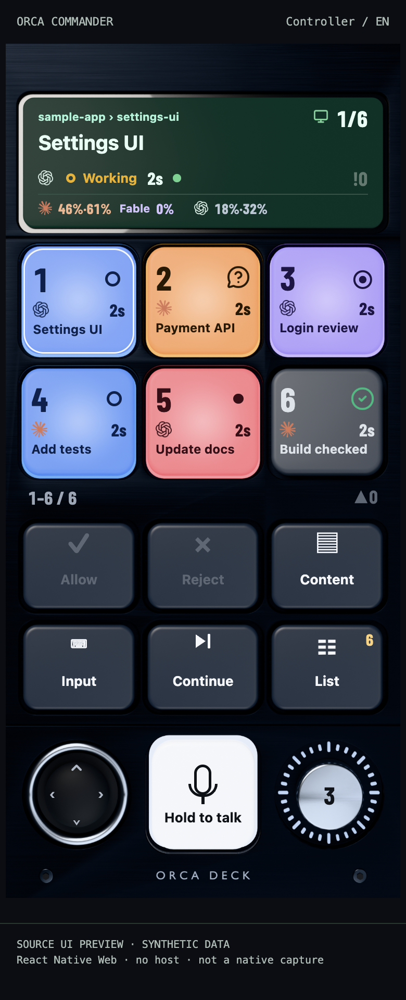
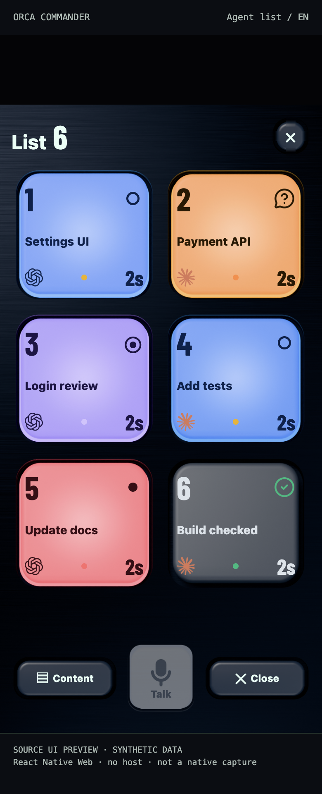
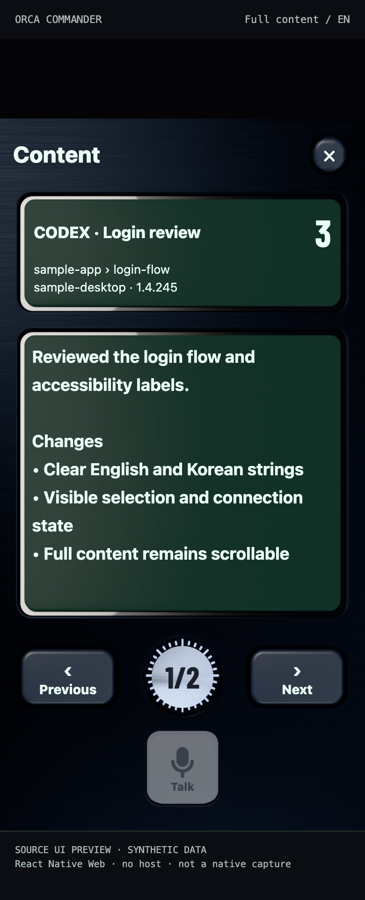
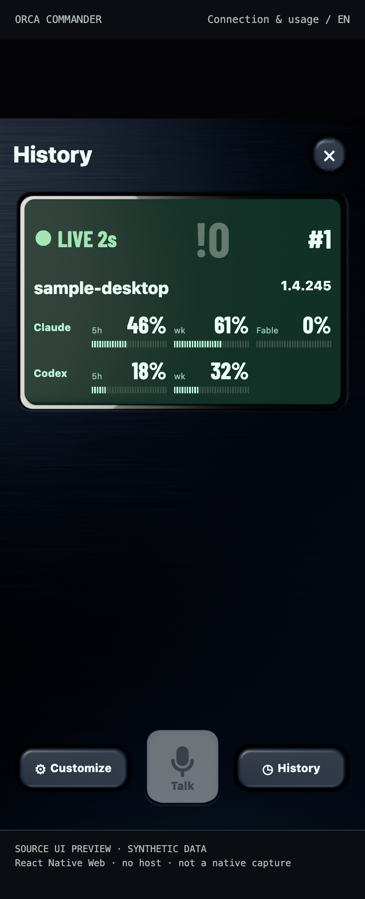
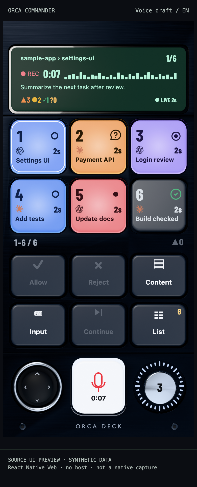
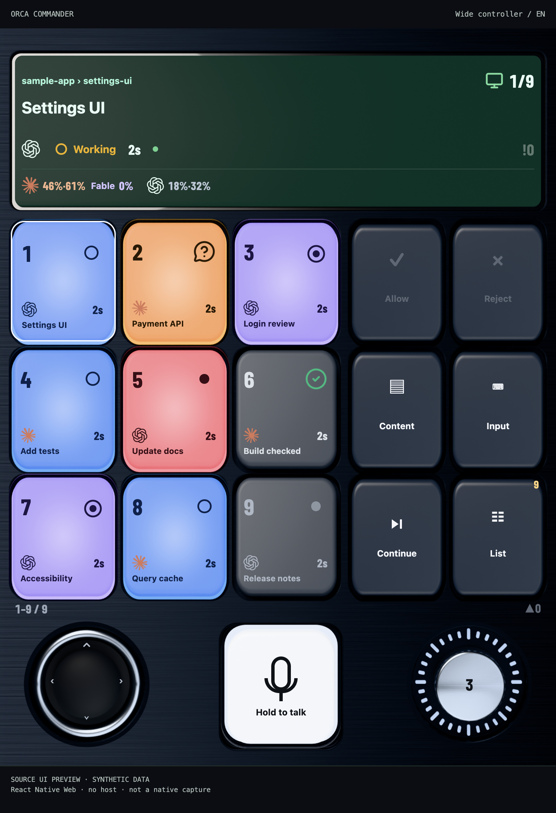
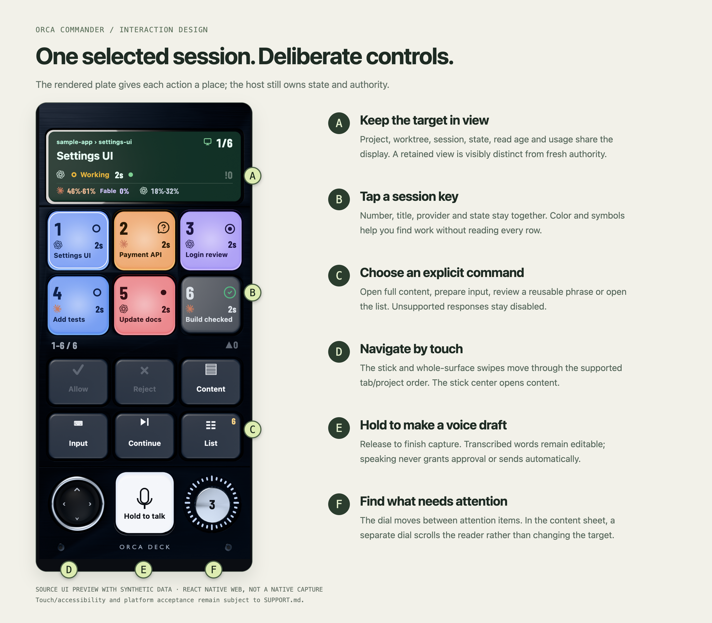
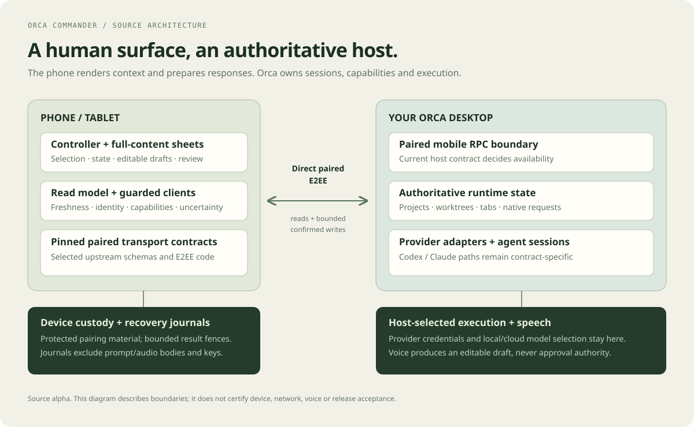

# Screen gallery

[Documentation](README.md) / Gallery

These images show the actual included controller and sheet components rendered on **React Native Web**, using bundled artwork and synthetic data. They are **not native-device screenshots**, connected sessions or evidence that a host action, speech model or permission flow succeeded.

Every task, identity, percentage, transcript and connection label is a fixture. Host action callbacks are inert. Native layout, typography, gestures, accessibility and platform APIs still need their own acceptance work.

## Controller: select and orient



The compact face groups selected context, six session keys, explicit commands and navigation/voice controls. Unsupported Allow/Reject controls stay disabled in this fixture; the selected working session is not an approval request.

Source: [DeckScreen](../apps/mobile/src/ui/deck/DeckScreen.tsx), [layout](../apps/mobile/src/ui/deck/deck-layout.ts), [domain view](../apps/mobile/src/core/deck-model.ts).

## Agent list: scan the inventory



The physical sheet uses the same state vocabulary as the controller. Selecting a row and opening its content remain separate from sending a response. This preview composes the source list, sheet frame and footer; it does not reproduce the entire connected app lifecycle.

Source: [AgentKeyList](../apps/mobile/src/ui/deck/deck-sheets.tsx), [sheet frame](../apps/mobile/src/ui/deck/sheet-frame.tsx).

## Content: read the received body



Identity and received text have distinct display regions. The reader is scrollable; page navigation and its dial move the viewport rather than slice/rewrite the original body. Content below the current viewport remains available by scrolling.

Source: [DeckContent](../apps/mobile/src/ui/deck/deck-sheets.tsx).

## Status: inspect connection and usage



The status component shows link/read age, unresolved count, connection generation, host/version and available host-reported usage. `LIVE`, `1.4.245` and all percentages here are fixtures, not a connected host or the maintainer's account data. The app presents this under its History sheet.

Source: [StatusDisplay](../apps/mobile/src/ui/deck/deck-sheets.tsx), [UsagePanel](../apps/mobile/src/ui/deck/usage-panel.tsx).

## Voice: present a draft, not authority



The recording display renders a level-scaled presentation waveform and transcript. This image contains no recorded audio, transcription request or working speech acceptance result. Native voice remains a host-selected draft flow with [known gaps](../SUPPORT.md).

Source: [RecordingDisplay](../apps/mobile/src/ui/deck/recording-display.tsx), [controller wiring](../apps/mobile/src/ui/deck/DeckScreen.tsx).

## Korean interface


The Korean catalog supplies labels and state text; task titles are synthetic Korean examples. This demonstrates the included catalog, not complete localization/accessibility acceptance.

Source: [Korean catalog](../apps/mobile/src/i18n/ko.ts), [English catalog](../apps/mobile/src/i18n/en.ts).

## Wide layout: a different visible capacity



The 821 × 1088 point fixture selects the wide geometry and nine visible session keys. It is a browser layout preview, not a named tablet/Fold capture or proof of rotation, retention, latency or accessibility.

Source: [approved face geometry](../apps/mobile/src/ui/deck/approved-face-geometry.ts), [DeckSkin](../apps/mobile/src/ui/deck/DeckSkin.tsx), [deck model](../apps/mobile/src/core/deck-model.ts).

## Design and system diagrams

[](DESIGN.md)

[](ARCHITECTURE.md)

[](USER_GUIDE.md#prepare-and-confirm-text)

The diagrams explain the source's intended boundaries. Dedicated controller hardware remains a future direction; none of these images depicts a delivered physical product.

## Where the images come from

The [showcase source](../scripts/showcase/README.md) imports actual TSX/domain modules, adapts platform-only presentation boundaries and supplies synthetic data. React layout effects run in a browser; the application entry, pairing storage, live transport and host action clients are not loaded. The build checks that unexpected live app adapters have not entered its import graph.

The app's mobile source, native IDs and lockfile are unchanged by this documentation work. The documentation renderer has its own pinned dependencies/lockfile. Source/artwork input hashes, tooling versions, fixture metadata and final image hashes are in [media provenance](media/README.md).

To regenerate the browser pages:

```sh
npm --prefix apps/mobile ci --ignore-scripts --no-audit --no-fund
npm --prefix scripts/showcase ci --ignore-scripts --no-audit --no-fund
node scripts/showcase/generate.mjs --out /tmp/orca-commander-preview
python3 scripts/showcase/serve.py --directory /tmp/orca-commander-preview
```

Open the local index. The optional [capture helper](../scripts/showcase/capture.py) uses an installed Aside CLI; any browser can inspect the pages. Browser/version, device pixel ratio and font rasterization affect screenshot bytes. Do not interpret image-hash integrity as cross-platform pixel equivalence or physical acceptance.
