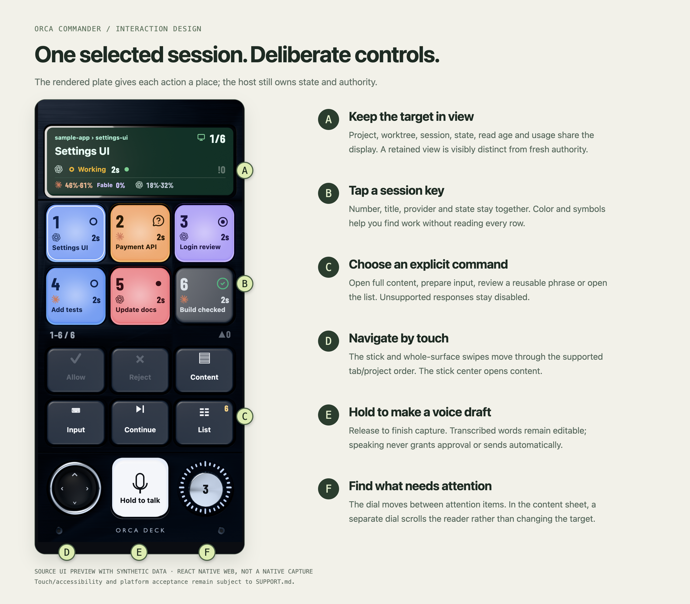

# Orca Commander documentation

A visual and technical guide to the source alpha. Start with what you want to do.

| Your goal | Read this |
|---|---|
| Understand the product in a minute | [Project introduction](../README.md) · [한국어 소개](../README.ko.md) |
| See the interface | [Screen gallery](GALLERY.md) |
| Build it and make a first connection | [Getting started](GETTING_STARTED.md) |
| Learn the controls and response flow | [User guide](USER_GUIDE.md) |
| Understand the physical-looking design | [Interaction and visual design](DESIGN.md) |
| Follow state, trust and data flow | [Architecture](ARCHITECTURE.md) |
| Find code, tests and extension boundaries | [Development guide](DEVELOPMENT.md) |
| Know what is supported | [Support matrix](../SUPPORT.md) · [Verification record](VERIFICATION.md) |
| Review plans and priorities | [Roadmap](ROADMAP.md) · [Changelog](../CHANGELOG.md) |
| Report, suggest or contribute | [Contributing](../CONTRIBUTING.md) · [Security policy](../SECURITY.md) |

## Visual map

The images render the actual included UI components on React Native Web with synthetic data. They are not screenshots of an iOS/Android build or a connected host. [Source, limitations and reproduction](GALLERY.md#where-the-images-come-from) are part of the gallery.

## Reading paths

**Evaluating the app:** introduction → gallery → user guide → support matrix.

**Developing a change:** getting started → architecture → development → contributing. Read the dependency-security status before running the source.

**Reviewing a design idea:** design → roadmap → the linked source components. Distinguish a proposed interaction from one already implemented and a source test from a physical observation.

## Reference material

- [Pinned upstream sources](UPSTREAM.md) and [third-party notices](../THIRD_PARTY_NOTICES.md).
- [Known dependency findings](DEPENDENCY_SECURITY.md); source checks do not clear this audit.
- [Asset source notes](deck-design/README.md) and [asset pipeline](../scripts/deck-assets/README.md).
- [Documentation preview tool](../scripts/showcase/README.md) and [media provenance](media/README.md).

There is no stable binary or store distribution. The native app retains the legacy Orca Deck name and IDs; the public project is Orca Commander. It is independent of the upstream Orca project.
