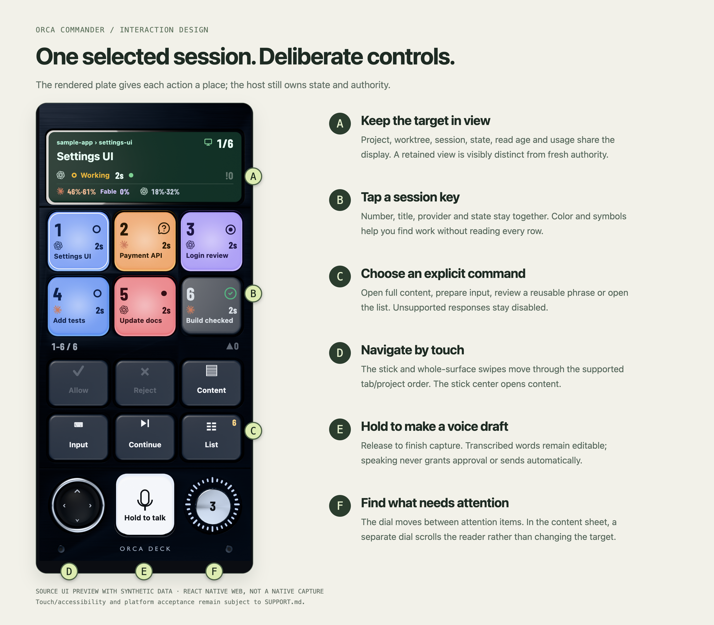

# Using Orca Commander

[Documentation](README.md) / User guide

Commander separates moving around work from preparing a response and from sending it. The Orca host remains the source of truth. The controls below describe the current source; availability still depends on [supported host contracts](../SUPPORT.md).

## The controller at a glance

The figure is a source UI preview with synthetic data. Letters are documentation annotations, not extra app buttons.

| Control | What it does |
|---|---|
| Session key | Select that visible session; number, title, provider and state stay together |
| Display | Shows selected context, position, state, read age, unresolved count and available usage; tapping opens status |
| Display long press | Resumes following the desktop selection where supported |
| Stick | Left/right moves within the tab order; up/down moves between projects where the current model permits; center opens content |
| Whole-surface swipe | Uses the same supported navigation directions; gestures that began on protected controls are excluded |
| Attention dial | Moves between attention items; it is separate from normal sequential navigation |
| Content | Opens the selected item's received content |
| Input | Prepares an editable message for an eligible target |
| Continue phrase | Opens the configured reusable phrase through confirmation; a long hold opens editing |
| List | Opens the agent-key list |
| Hold to talk | Captures a voice draft when available; release finishes capture |
| Allow / Reject / Answer | Only offered for a supported current request; disabled is meaningful, not a missing shortcut |

The exact navigation wiring is in [DeckScreen](../apps/mobile/src/ui/deck/DeckScreen.tsx) and [DeckHome](../apps/mobile/src/ui/deck-home.tsx). A title is a label, not target authority.

## Read the display before acting

Check the selected project/worktree and session title. A position such as `1/6` is an inventory position, not permission. Read age and connection state describe whether context is current; retained context is visibly separated from fresh state.

Usage values come from the host's supported account-usage response. A missing value stays unknown. The documentation images use fixed percentages and do not represent the maintainer's accounts, costs or remaining balance.

A partial inventory can be marked as a lower bound. Do not infer that every session or host is represented merely because the displayed count is known.

## Recognize state without relying only on color

| State | Visual treatment in the source |
|---|---|
| Working | Blue lit key with a working ring; progress mark uses the host-inspired yellow |
| Question / permission | Warm amber key and question mark |
| Review | Violet key and review mark |
| Failed | Red key and fault mark |
| Done | Resting dark key with a green check; completion does not keep the key brightly lit |
| Unknown / unconfirmed / stale | Explicit uncertainty mark; never treated as proven success |
| Monitoring / stopping | Separate display semantics; not simply another running/completed state |

Titles, symbols, provider marks, state text and accessibility labels accompany color. Complete VoiceOver/TalkBack and every large-text layout are still open acceptance work. [Design details →](DESIGN.md#state-language)

## Read full context

Open **Content** for the selected item. The identity area and full received body remain available; the reader scrolls internally. Previous/next page controls and the reader's dial move the viewport, not the host target or original text.

The session-key caption may ellipsize to fit a small key. That does not imply the full content was shortened. Read the complete target and text again in the confirmation flow before any supported response.

## Prepare and confirm text

1. Select the intended session and open **Input**.
2. Write or edit the message. Voice text is also a draft at this stage.
3. Prepare the confirmation and review its full identity and body.
4. Use the deliberate confirmation gesture. The touch path requires a continuous 0.8-second hold; accessibility uses its own explicit activation flow.
5. Let the action client revalidate and attempt once. Read the reported outcome and inspect the host when needed.

Preparation performs no mutation. A connection generation, target, request revision or presentation change can invalidate the flow. Missing capability, unavailable journal/storage or an unresolved result can block sending. Do not try to bypass those refusals by changing mode, reconnecting or clearing data.

## Understand the result

**Accepted** means the supported host boundary reported acceptance. It does not mean the agent completed the task or that the task succeeded.

**Refused or invalidated** means this attempt should not be treated as delivered. Read the reason, refresh context and prepare a new confirmation only when appropriate.

**Unknown or partially sent** needs reconciliation at the host. The app preserves recovery metadata and blocks unsafe repeats. Check the actual result before acknowledging. Acknowledging uncertainty is not an automatic resend. Uninstalling, clearing data or restoring an old backup can remove local fences.

## Voice is an editable draft

The host owner selects the speech model. A cloud model may receive audio through the host's configured service; check the model/context before capture. Hold/release and cancellation/background/disconnection guards belong to the native flow.

Review the transcript, fix it and choose the target before confirming a supported send. Spoken words cannot grant permission, approve a command or silently submit text. Full voice roundtrip, narration, interruptions and broad recognition accuracy remain unaccepted end to end.

The gallery's waveform and transcript are fixtures. They do not record sound or invoke a model.

## Requests and approvals are bounded

Commander includes narrow Codex native-response and Claude terminal-question paths. It does not promise that every terminal prompt, plan, provider, permission menu or orchestration gate is answerable. A response that cannot be tied to current verified request evidence stays unavailable.

Use Orca directly for unsupported cases. The [support matrix](../SUPPORT.md) distinguishes implemented source, selected observations and remaining limitations.

## Responsive layouts and preferences

The source has a six-key compact/tall-phone layout and nine-key wide layouts, plus responsive landscape geometry. A larger key grid changes visible capacity; it does not create new permissions or protocols.

English and Korean are built in. Preferences include screen-mode and click-sound choices; language packs have separate bounded review/import handling. Mode/language changes do not bypass confirmation ownership. Automatic mode can choose a list presentation when the controller is unsuitable, including accessibility/space conditions defined in the source.

For first setup see [getting started](GETTING_STARTED.md). For diagnostics, share only versions, state and a minimal reproduction; keep pairing material and owner content private.
